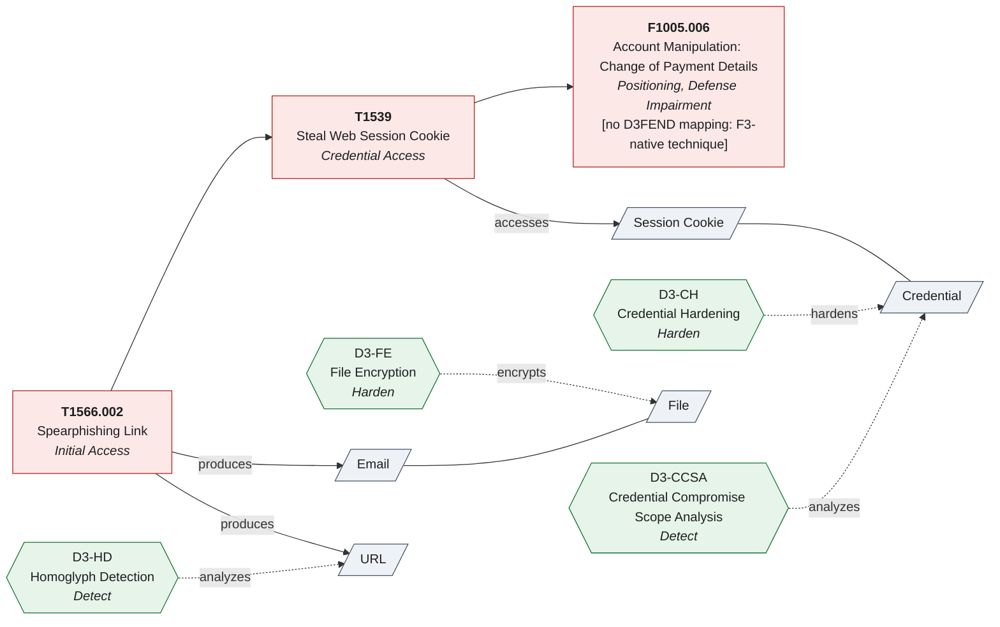

# Countermap

Countermap puts the **Fight Fraud Framework (F3)** in one local knowledge graph with **MITRE ATT&CK®** (Enterprise, Mobile, ICS), **D3FEND** and **ATLAS**, and serves it read-only to AI agents over MCP and to people from the command line. Every cross-framework link says whether MITRE published it or Countermap derived it, and one small scenario spec renders validated **D3FEND CAD** graphs, **Attack Flow 2.0** bundles, **ATT&CK Navigator** layers and **Mermaid** diagrams.

- **Fraud and intrusion in one graph.** F3 techniques sit beside ATT&CK, D3FEND and ATLAS, with F3's reuse of ATT&CK IDs and ATLAS's ATT&CK references kept as MITRE publishes them.
- **Provenance on every link.** Each link is `official` (published by MITRE), `derived` (with the path it was composed through) or `analyst`, and an empty D3FEND result says why it is empty.
- **Schema-validated diagrams.** The D3FEND CAD graph and the Attack Flow bundle are checked against their published schemas before they are returned.
- **Telemetry and rule coverage.** What your log sources and detection rules cover against MITRE's analytics, with the gaps ranked by how many groups ATT&CK links to them.
- **Offline and air-gapped builds.** One SQLite file and no network at query time; builds pin each upstream release by SHA-256 and can read every source from a mirror or a local file.

Status: alpha (0.2.1). Built against ATT&CK v20.0, F3 v1.2, ATLAS 2026.09 and D3FEND 1.6.0. See the [architecture document](https://github.com/elchacal801/countermap/blob/main/docs/ARCHITECTURE.md) for the design and the provenance and coverage rules, the [changelog](https://github.com/elchacal801/countermap/blob/main/CHANGELOG.md) for each release, [SECURITY.md](https://github.com/elchacal801/countermap/blob/main/SECURITY.md) to report a vulnerability and [CONTRIBUTING.md](https://github.com/elchacal801/countermap/blob/main/CONTRIBUTING.md) to contribute.

## Quick start

```bash
pipx install countermap                                    # or pip install countermap; Python 3.10 or newer
countermap build                                           # about 150 MB of MITRE data, downloaded once
countermap gaps T1566.002 T1539 F1005.006                  # mitigations, detections and D3FEND per technique
claude plugin install countermap --marketplace elchacal801/countermap   # the MCP server and skills for Claude Code
```

## Example



Rendered by `countermap render examples/aitm-cookie-to-payment-change.json --format mermaid` against the releases in `sources.lock.json`. Each official D3FEND countermeasure (green) connects to its attack step through digital artifacts (gray), as D3FEND's published mappings link them, and the F3 step says why it has none. The same spec also renders the CAD graph, the Attack Flow bundle and the Navigator layers.

## Why this exists

When an agent says "D3-MFA counters this F3 technique", a reader needs to know whether MITRE published that link or whether it was stitched together. Countermap enforces three rules:

1. **Stored links are only what MITRE publishes.** ATT&CK relationships, ATLAS's ATT&CK references, F3's reuse of ATT&CK IDs, and D3FEND's published inference output. Nothing inferred is stored.
2. **Derived links are labeled and carry their path.** For example `F3 reuses ATT&CK ID attack:T1056 -> sub-technique attack:T1056.001`. Agents are told never to present them as MITRE's.
3. **Gaps are reported as gaps, with the reason.** An empty D3FEND result carries a `gap_reason`: D3FEND maps nothing to the technique (`no_mapping`), the loaded D3FEND release predates it (`predates`; ATT&CK v20's new AI techniques are not in D3FEND 1.6.0 yet), it is an F3-native technique (`f3_native`), or none is in the requested tactic (`none_in_tactic`). When the D3FEND data is not loaded at all, the reason is `unavailable`, which is never counted as a gap.

It also reports upstream data problems the frameworks do not flag themselves. Against the current releases it reports, for example, that F3 still reuses `T1672` (revoked in ATT&CK, now `T1684.002`) and two sub-technique IDs that ATT&CK does not contain, that ATLAS `AML.T0073` references the revoked `T1656`, and that ATT&CK ICS publishes a deprecated object under an ID Enterprise uses for different malware.

## Install

```bash
pip install countermap      # into the current environment
pipx install countermap     # as an isolated command-line tool
uvx countermap --help       # run it without installing (requires uv)
```

With [uv](https://docs.astral.sh/uv/), prefix any command below with `uvx`, for example `uvx countermap build`. Dependencies: `mcp` (2.x), `rdflib`, `jsonschema`, `referencing`, `pydantic`, `PyYAML`.

From source:

```bash
git clone https://github.com/elchacal801/countermap && cd countermap
python -m venv .venv && . .venv/bin/activate      # Windows: .venv\Scripts\activate
pip install -e ".[dev]"
pytest -q                                         # offline test suite
```

## Build the database

```bash
countermap build                                # latest upstream releases
countermap build --lock sources.lock.json       # exactly the releases in a lock file, verified by SHA-256 where pinned
countermap build --attack-version 19.2          # pin ATT&CK
countermap diff ~/.cache/countermap/countermap.prev.db ~/.cache/countermap/countermap.db
```

A build takes a few seconds after download. Each rebuild keeps the previous snapshot so `version_diff` can show what changed.

A build fails, and leaves the existing database as it was, when a required source (every source except `d3fend-mappings`) cannot be fetched or parsed. `countermap build --allow-partial` builds without it instead: the database is marked degraded, `countermap info` and the `datasets` tool show `degraded: true` and the missing sources, and without D3FEND, countermeasure results say `unavailable` rather than empty.

A lock file pins each upstream release by URL and SHA-256. The repository's [`sources.lock.json`](https://github.com/elchacal801/countermap/blob/main/sources.lock.json) pins the releases the project is currently tested against; download it to build exactly those, or write a lock for the latest releases with `countermap lock -o sources.lock.json`.

A lock pins each source's primary URL, and a build from it never falls back to another location. The D3FEND file in the tagged GitHub release is not byte-identical to the release file d3fend.mitre.org serves, so it could not pass the pinned hash anyway. On a network that blocks an upstream host, build from a mirror or a local copy instead (below).

Sources and where they come from:

| Key | Upstream |
|---|---|
| `attack-enterprise`, `attack-mobile`, `attack-ics` | `mitre-attack/attack-stix-data` (STIX 2.1, resolved through its `index.json`) |
| `f3` | `center-for-threat-informed-defense/fight-fraud-framework` `public/f3-stix.json` |
| `atlas` | `mitre-atlas/atlas-data` `dist/manifest.yaml`, newest v6 YAML |
| `d3fend-ontology` | `d3fend.mitre.org/ontologies/d3fend/<version>/d3fend.ttl` for the release `d3fend.mitre.org/api/version.json` reports, falling back (without a lock) to the tagged release in `d3fend/d3fend-ontology` |
| `d3fend-mappings` | `d3fend.mitre.org/ontologies/d3fend/<version>/d3fend-full-mappings.json` (optional; countermeasure queries report "unavailable" without it) |

**Mirrors and air-gapped use.** Every source accepts a URL or a local path:

```bash
countermap build --source attack-enterprise=/mirror/enterprise-attack-20.0.json --source d3fend-mappings=/mirror/d3fend-full-mappings.json
# or per source: COUNTERMAP_URL_ATTACK_ENTERPRISE=https://ghe.example.com/raw/... countermap build
```

With `--lock`, the `COUNTERMAP_URL_<KEY>` variables do not apply, and `--source` replaces that source's locked URL and hash, so the file it names is not verified. To keep the check, edit the entry's `url` in a copy of the lock (a byte-identical copy keeps the pinned `sha256`), or write a lock for the mirror with `countermap lock --source KEY=PATH_OR_URL`.

`COUNTERMAP_DB` and `COUNTERMAP_CACHE` move the database and download cache.

## Use it from an agent (MCP)

VS Code (Copilot agent mode) reads `.vscode/mcp.json` in your workspace:

```json
{ "servers": { "countermap": { "type": "stdio", "command": "countermap", "args": ["serve"] } } }
```

Claude Code: install the plugin, which bundles the MCP server with two skills. `countermap` teaches Claude the tools and the provenance rules; `/countermap:threat-model` turns an incident or report into a mapped scenario, countermeasures, gaps and diagram files.

```bash
claude plugin install countermap --marketplace elchacal801/countermap
```

This shell form needs Claude Code v2.1.292 or later; inside a session, `/plugin install countermap --marketplace elchacal801/countermap` needs v2.1.275 or later. On older versions, add the marketplace first:

```bash
claude plugin marketplace add elchacal801/countermap
claude plugin install countermap@countermap
```

The plugin starts the server from PyPI with [uv](https://docs.astral.sh/uv/) (`uvx countermap@0.2.1 serve`), so uv must be on your PATH. On first use Claude offers to build the database (about 150 MB of downloads, once). Without the plugin: `claude mcp add --transport stdio countermap -- countermap serve` (use the full path to the executable if `countermap` is not on PATH, or `-- uvx countermap serve`). Any stdio MCP client works the same way.

**Updating the plugin.** Auto-update is off by default for third-party marketplaces. To update:

```bash
claude plugin marketplace update countermap
claude plugin update countermap@countermap
```

The new version loads in the next session, or after `/reload-plugins`. To turn on auto-update, run `/plugin`, open the Marketplaces tab, select countermap and choose Enable auto-update.

| Tool | What it returns |
|---|---|
| `datasets` | Loaded versions, SHA-256, licenses, object counts, build warnings, and whether the database is degraded |
| `search` | Full-text search over names, aliases, IDs, descriptions |
| `lookup` | Any object by ID, name or alias; revoked IDs followed to their replacement. Detection strategies, analytics and data components also show their analytics, log sources, tunables and techniques; campaigns show their first and last seen dates |
| `technique_context` | Tactics, sub-techniques, users, mitigations, detection strategies with each analytic's description, tunables and log sources, D3FEND, crosswalk |
| `countermeasures` | D3FEND countermeasures with artifact paths, official or derived, and a `gap_reason` when there are none |
| `crosswalk` | ATLAS and F3 links to ATT&CK, flagged when the target is revoked, deprecated or missing |
| `actor_techniques` | Techniques for a group, software or campaign (optionally through its software) |
| `compare_actors` | Shared and unique techniques, pairwise Jaccard |
| `coverage_gaps` | Mitigation, detection-strategy and D3FEND counts for a technique list, with the reason for each missing D3FEND mapping |
| `telemetry_coverage` | What your log sources and data components can detect: each technique of a list, an actor or a platform (in one ATT&CK domain or all three) as covered, partial or blind against MITRE's analytics, with the log sources missing; optional Navigator layer, up to 120 techniques over MCP |
| `rule_coverage` | What your detection rules cover: given the ATT&CK IDs your rules map to, each in-scope technique as covered, partial or uncovered, with gaps ranked by how many groups ATT&CK links to them, directly or through software they use (the latter derived by Countermap); optional Navigator layer, up to 120 techniques over MCP |
| `version_diff` | Added, removed, revoked, deprecated, renamed, re-tacticed objects since the last build |
| `navigator_layer` | Navigator layer 4.5 JSON per domain, including F3's Navigator domain |
| `render_scenario` | CAD, Attack Flow, Mermaid and Navigator output from a scenario spec, plus the mitigations and detection strategies (with their analytics) MITRE links to each step, and why a step has no countermeasures |

The same queries work from the shell: `countermap lookup "Cozy Bear"`, `countermap counter T1539`, `countermap gaps T1566.002 T1539 F1005.006`, `countermap info`.

Coverage from the shell, with an optional Navigator layer file:

```bash
countermap coverage --log-source WinEventLog:Sysmon --log-source "WinEventLog:Security EventCode=4688" --platform Windows --actor APT29 --layer apt29-telemetry.json
countermap rules-coverage --sigma ./rules --actor APT29 --layer apt29-rules.json     # or --technique T1059.001 --technique T1003 ...
```

The telemetry and rule coverage classes, and the gap ranking, are Countermap's computations over MITRE's analytics and "uses" relationships; each result says so in its `basis`. Group counts are the groups ATT&CK links to a technique directly, or through software they use (the latter derived by Countermap), not how common it is in the wild; each count says how many are direct. Over MCP, a coverage layer is returned for up to 120 techniques; for a broader target the result points to the CLI's `--layer FILE`, which has no limit.

## Diagrams: the scenario spec

Agents never hand-write CAD JSON or STIX. They write this, and Countermap checks every ID against the loaded data:

```json
{
  "title": "AiTM phishing to payment redirection",
  "steps": [
    {"id": "s1", "technique": "T1566.002", "description": "Link to an AiTM reverse proxy"},
    {"id": "s2", "technique": "T1539", "after": ["s1"], "assets": ["Victim mailbox"]},
    {"id": "s3", "technique": "F1005.006", "after": ["s2"]}
  ],
  "countermeasures": "auto",
  "max_countermeasures_per_step": 2
}
```

Save it as `scenario.json` and render it:

```bash
countermap render scenario.json -o out/
```

This spec is the diagram above. Three complete specs are in the repository's [`examples/`](https://github.com/elchacal801/countermap/tree/main/examples) folder: this one, a longer AiTM phishing to payment fraud case, and an agentic prompt injection.

- **D3FEND CAD**: attack steps, the digital artifacts they act on, and the countermeasures that act on those artifacts, so every countermeasure connects to the attack through an artifact. Validated against the published CAD schema. Open it in CAD with *Load*.
- **Attack Flow 2.0**: validated against the CTID schema; passes CTID's own `af validate` with no warnings.
- **Navigator**: one layer per domain; F3 steps go on an F3 layer that uses the same domain and data URL as the layer CTID publishes for F3.
- **Mermaid**: renders in GitHub, VS Code and most wikis.

`"countermeasures": "auto"` picks official D3FEND countermeasures first, one tactic at a time (Harden, Detect, Isolate, Evict, Restore, Deceive, Model), preferring ones that act on the same artifact as the attack. A step that gets none is listed in `steps_without_countermeasures` with its `gap_reason`, and every format labels it with the reason. You can also list countermeasures explicitly; ones D3FEND does not map to that step are drawn and labeled as analyst assertions.

### CAD calibration

The public CAD schema does not specify edge handle IDs or the current `cad_schema_version`. Countermap writes what CAD itself writes (handles `source` and `target`, schema version 1, checked against CAD 0.26.1 on 2026-10-15). The layout leaves room for the size CAD actually draws each node. If a future CAD release changes these values, export any graph from [D3FEND CAD](https://d3fend.mitre.org/cad/) that has at least one connection, then:

```bash
countermap calibrate-cad exported-from-cad.json
```

## Keeping current

`countermap check-updates --lock FILE` compares the latest upstream releases with a lock file and exits with code 10 when any of them has moved past it.

The repository runs that check in a scheduled `upstream-sync` GitHub Actions workflow (daily at 06:17 UTC, or by hand). When an upstream release version differs from `sources.lock.json`, the workflow writes a new lock, builds against the new data, runs the offline test suite, the live test and a lookup smoke test, diffs the old and new ATT&CK snapshots, and opens a pull request that changes only the lock file, with the version changes, the ATT&CK diff counts and the build warnings in its body. Nothing merges on its own.

## Security and data handling

- The server opens the database read-only and makes no network calls; tools cannot write files or run commands.
- MCP tools take IDs, never file paths. Reading Sigma rules is a CLI-only step (`rules-coverage --sigma`), which parses YAML with `yaml.safe_load_all` and never runs anything in it. It does not follow symlinks or junctions, skips files over 1 MiB or nested more than 100 brackets deep, and counts any file it cannot parse instead of stopping.
- Only `build`, `lock` and `check-updates` touch the network, and only the upstream URLs above (or your overrides).
- Tool results contain upstream MITRE text. Treat it as data, not instructions.
- Scenario specs stay local. Nothing is sent anywhere.

To report a vulnerability, see [SECURITY.md](https://github.com/elchacal801/countermap/blob/main/SECURITY.md).

## Limitations

- D3FEND's published mappings are the only source of countermeasure links. The parser expects MITRE's SPARQL result columns (`off_tech_id`, `def_tech`, `def_artifact_label`, ...). If the columns change or no row can be used, the build marks the mappings `failed`, records a warning, and countermeasure queries report "unavailable" rather than "no coverage".
- D3FEND moved its published mappings once already: release 1.6.0 dropped the old `api/ontology/inference/` path for the versioned release folder. If the location changes again, the build marks the mappings `unavailable` with the HTTP error rather than guessing.
- Names are matched exactly (case-insensitive) and by alias. When a name matches several objects (for example "Phishing" exists in ATT&CK Enterprise, Mobile, F3 and ATLAS), ATT&CK wins and the result carries a warning listing the others. Pass IDs when it matters.
- D3FEND lags ATT&CK. D3FEND 1.6.0 aligns to ATT&CK 19.0 (per its CHANGELOG) and has no classes for v20's new techniques, so they have no countermeasures yet. It also still maps 22 techniques that ATT&CK had already revoked, while 20 of their replacements have no mappings of their own; Countermap reaches those replacements only through `derived` links that name the revoked ID.
- F3 has no published mitigations or data sources yet, so F3-native techniques have no countermeasures.
- CAPEC, CWE and NIST mappings are not included.

## Contributing

See [CONTRIBUTING.md](https://github.com/elchacal801/countermap/blob/main/CONTRIBUTING.md) for the development setup, the tests and the provenance rules every change keeps.

## License

Apache-2.0, except the 12 OASIS STIX 2.1 JSON schemas vendored for offline validation, which are BSD-3-Clause; their license text is in [`LICENSES/BSD-3-Clause-OASIS.txt`](https://github.com/elchacal801/countermap/blob/main/LICENSES/BSD-3-Clause-OASIS.txt). [`NOTICE`](https://github.com/elchacal801/countermap/blob/main/NOTICE) lists MITRE attributions, trademarks and the license of every vendored schema. Both files also ship inside the package. This project is not affiliated with or endorsed by MITRE.
